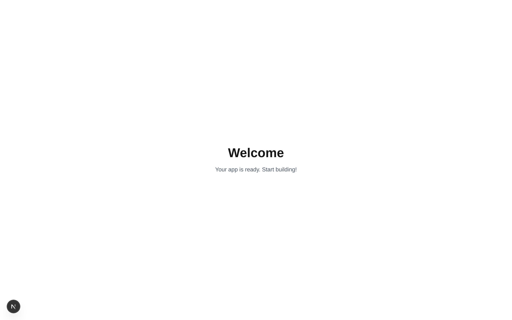

# BNDH Consulting

[](https://codespaces.new/jaredcosulich/bndh-consulting?quickstart=1)

A sports-consulting site for international athletes, parents, guardians and coaches: it explains college scholarships in the USA and professional tennis academies, and lets visitors book a consultation (including virtual) with a sports-abroad expert.

## Work on this project in your browser

You don't need to install anything or know how to code. The button above opens the project in a **GitHub Codespace**, a computer GitHub runs for you inside your browser. It comes with the **CodeYam Editor**, where you describe changes in plain words and an AI builds them while you watch the site update.

### Before you start

- **A GitHub account that has been invited to this project.** Accept the invitation email from GitHub first. Without it, the button shows a "404" or "not found" page.
- **A Claude account** (claude.ai). The editor asks you to sign in to it the first time. A paid Claude plan is recommended.
- **Google Chrome.** Safari and Edge can block or freeze the editor.

### Your first time

1. **Click the "Open in GitHub Codespaces" button** above, then click the green **Create codespace** button. If GitHub offers to resume a codespace you already have, choose that instead. It keeps your earlier work.
2. **Wait a few minutes.** A code-editor window opens in your browser. A welcome page appears, and the panel along the bottom shows the setup running. Nothing there needs your attention.
3. **Open the editor.** When it's ready, the bottom panel shows a box saying **"CodeYam Editor is ready"** with a link. Hold **Cmd** (Mac) or **Ctrl** (Windows) and click the link. If your browser says it blocked a pop-up, choose **always allow** for this site.
4. **Sign in to Claude** when the editor asks, then describe what you'd like to change.

### Good to know

- **Keep the first browser tab (the code-editor window) open in the background** while you work. If you close it, GitHub may switch the codespace off while you're still using the editor.
- **Coming back later:** go to [github.com/codespaces](https://github.com/codespaces) and open your codespace again. Your files are still there.
- **Saving your work:** when the editor finishes a change, it asks to save it to GitHub. Say yes. Work that isn't saved there stays only inside your codespace, and GitHub deletes codespaces that haven't been used for about 30 days.
- **Cost:** GitHub accounts include a monthly allowance of free codespace time. This project uses a 4-core machine, which works out to roughly 30 hours a month. You can check your usage under GitHub **Settings → Billing**.
- **Who can see it:** only you. Others who open the project get their own separate codespace.
- **If the editor doesn't appear:** close the codespace tab and open it again from [github.com/codespaces](https://github.com/codespaces). The editor restarts on its own. If it still doesn't come up, ask the project owner for help.

## For developers

### Codespaces setup

The setup lives in `.devcontainer/`. The `codeyam-*` files are generated by `codeyam-editor editor devcontainer-setup`. `project-setup.sh` is specific to this project (`npm ci`, `prisma db push`, and seeding a brand-new database). It runs on create and on every start, so a first start that was interrupted repairs itself.

### Setup

Run the setup script to install dependencies, initialize the database, and seed it with demo data:

```bash
npm run setup
```

### Development

Start the dev server:

```bash
npm run dev
```

Open [http://localhost:3000](http://localhost:3000) in your browser.

### Using CodeYam Editor

This project was built with [CodeYam](https://codeyam.com). To launch the editor:

```bash
codeyam editor
```

The editor provides a live preview alongside a Claude Code terminal for iterating on the app.

### Database

This project uses SQLite via Prisma. Common commands:

```bash
npm run db:push    # Apply schema changes and generate Prisma client
npm run db:seed    # Seed the database with demo data
npm run db:reset   # Reset database: drop, recreate, and re-seed
```

### Scripts

| Script             | Description                                  |
| ------------------ | -------------------------------------------- |
| `npm run setup`    | One-line project setup (install + db + seed) |
| `npm run dev`      | Start the development server                 |
| `npm run build`    | Build for production                         |
| `npm run test`     | Run tests                                    |
| `npm run db:push`  | Apply Prisma schema changes                  |
| `npm run db:seed`  | Seed the database                            |
| `npm run db:reset` | Reset and re-seed the database               |

<!-- codeyam:run-and-edit:start d=e57883f0c068 -->
## Develop this project with codeyam-editor

This project is built with [codeyam-editor](https://codeyam.com) — code and runnable data scenarios are authored side by side against a live preview.

```bash
# Clone the repo
git clone https://github.com/jaredcosulich/bndh-consulting && cd bndh-consulting

# Install codeyam-editor
npm install -g @codeyam-editor/codeyam-editor@latest

# Launch the editor (split-screen terminal + live preview)
codeyam-editor start
```
<!-- codeyam:run-and-edit:end -->

<!-- codeyam:scenario-gallery:start d=78239a56f109 -->
## Scenario gallery

States captured as runnable scenarios with codeyam-editor:

### Home - Starter Placeholder



The starter welcome page shown at / before the BNDH landing page is built.
<!-- codeyam:scenario-gallery:end -->
